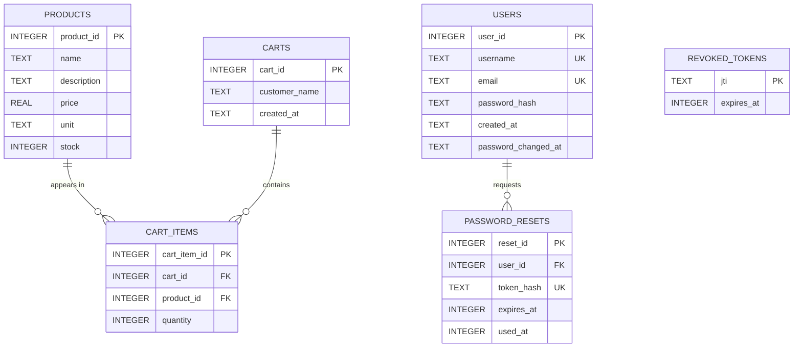

# Sprint 4 — Database Design

**Project:** Buildmart Secure Retail System
**Group:** Group 2 — Ranjan, Kalyan, Shailendra, Diya, Dipesh, Sujan, Anjan
**Database:** SQLite, through the `better-sqlite3` package
**Created by:** `backend/init-db.js` and `backend/auth/schema.js`

This describes the database as it is built now. It replaces the planned model in [`docs/week4/data-dictionary.md`](../week4/data-dictionary.md), which was written before the backend existed.

## Entity Relationship Diagram

The database has **6 entities**: three for the shop and three for user accounts.

## Relationships

| Relationship | Type | Foreign key | What it means |
| --- | --- | --- | --- |
| carts → cart_items | One-to-many | `cart_items.cart_id` | One cart holds many lines |
| products → cart_items | One-to-many | `cart_items.product_id` | One product can be in many carts |
| users → password_resets | One-to-many | `password_resets.user_id` | One user can request many resets |

`cart_items` resolves the many-to-many relationship between carts and products. `revoked_tokens` stands alone because it stores the ID of a logged-out token, not a link to a user.

**Known limitation:** `carts` is not linked to `users` yet. The shop page uses one shared cart (cart 1), so the cart is saved in the database but does not belong to a logged-in user. Linking them is listed under future improvements in the README.

## Data dictionary

### products

| Column | Type | Rules | Description |
| --- | --- | --- | --- |
| product_id | INTEGER | Primary key | Unique product number. `shop.html` uses it to pick the icon |
| name | TEXT | Required | Name shown to the customer |
| description | TEXT | Optional | Short detail, for example "Fibreglass handle" |
| price | REAL | Required, 0 or more | Price in AUD, including GST |
| unit | TEXT | Required, defaults to each | Selling unit: each, tin, length or pair |
| stock | INTEGER | Required, 0 or more | Units available |

### carts

| Column | Type | Rules | Description |
| --- | --- | --- | --- |
| cart_id | INTEGER | Primary key | Unique cart number |
| customer_name | TEXT | Required | Name on the cart |
| created_at | TEXT | Required, defaults to now | When the cart was created |

### cart_items

| Column | Type | Rules | Description |
| --- | --- | --- | --- |
| cart_item_id | INTEGER | Primary key | Unique line number |
| cart_id | INTEGER | Required, foreign key to carts | The cart this line belongs to |
| product_id | INTEGER | Required, foreign key to products | The product on this line |
| quantity | INTEGER | Required, more than 0 | Units of the product |

`cart_id` and `product_id` are unique together, so a product appears only once per cart. Adding it again raises the quantity.

### users

| Column | Type | Rules | Description |
| --- | --- | --- | --- |
| user_id | INTEGER | Primary key | Unique user number |
| username | TEXT | Required, unique in any letter case | Login display name |
| email | TEXT | Required, unique in any letter case | Used to log in |
| password_hash | TEXT | Required | bcrypt hash. The password itself is never stored |
| created_at | TEXT | Required, defaults to now | When the account was created |
| password_changed_at | TEXT | Optional | Login tokens issued before this time stop working |

### password_resets

| Column | Type | Rules | Description |
| --- | --- | --- | --- |
| reset_id | INTEGER | Primary key | Unique reset number |
| user_id | INTEGER | Required, foreign key to users | Who asked for the reset |
| token_hash | TEXT | Required, unique | SHA-256 hash of the reset token |
| expires_at | INTEGER | Required | When the token expires (30 minutes after it is made) |
| used_at | INTEGER | Optional | When the token was used. Tokens work once |

### revoked_tokens

| Column | Type | Rules | Description |
| --- | --- | --- | --- |
| jti | TEXT | Primary key | ID of a login token that was logged out |
| expires_at | INTEGER | Required | When the token would expire. Expired rows are cleaned up on logout |

## Business rules

| # | Rule | Where it is enforced |
| --- | --- | --- |
| 1 | A cart line must point to a real cart and a real product | Foreign keys, plus 404 from the API |
| 2 | Quantity must be a whole number above 0 | `CHECK` constraint, plus 400 from the API |
| 3 | A customer can have at most 20 of one product | API returns 400 |
| 4 | A customer cannot add more than the stock available | API returns 409 |
| 5 | A product appears only once per cart | `UNIQUE(cart_id, product_id)` |
| 6 | Prices include GST. GST shown is total − total / 1.1 | `getCart` in `backend/server.js` |
| 7 | Usernames and emails are unique in any letter case | `UNIQUE COLLATE NOCASE` |
| 8 | Passwords are stored only as bcrypt hashes | `backend/auth/passwords.js` |

## Seed data

`npm run init-db` adds the 8 shop products with stock, plus an empty cart 1. `npm run reset-db` deletes everything, including user accounts, and rebuilds this seed.

| product_id | name | description | price | unit | stock |
| --- | --- | --- | --- | --- | --- |
| 1 | Bolt | Zinc plated, M10 | 12.00 | each | 50 |
| 2 | Claw Hammer 450g | Fibreglass handle | 24.95 | each | 20 |
| 3 | Interior Paint 4L | Low-sheen, white | 58.00 | tin | 15 |
| 4 | Pine Timber 2.4m | 90 x 45mm treated | 12.40 | length | 40 |
| 5 | LED Work Light | 2000 lumen, rechargeable | 79.50 | each | 8 |
| 6 | Tape Measure 8m | Magnetic hook | 18.90 | each | 25 |
| 7 | Garden Hose 30m | Kink-resistant | 44.00 | each | 10 |
| 8 | Safety Glasses | Anti-fog, clear | 9.95 | pair | 3 |

Stock is checked when items are added, but it does not go down yet because orders are not built.
